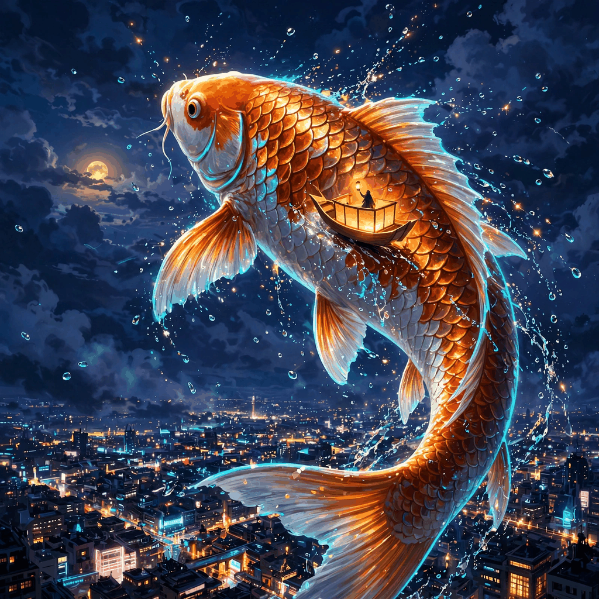

# ai-excited

[](https://make.fun/bounty/ai-excited-01?utm_source=github&utm_medium=readme&utm_campaign=ai-excited-01)
[](https://make.fun/bounty/ai-excited-01/leaderboard?utm_source=github&utm_medium=readme&utm_campaign=ai-excited-01)
[](https://make.fun/bounty/ai-excited-01?utm_source=github&utm_medium=readme&utm_campaign=ai-excited-01)

"The Lantern Koi" — a colossal koi fish leaps in a huge arc over a neon city at night, a tiny glowing paper-lantern boat riding on its back. An original image made to excite make.fun's AI judge.

The idea is impossible scale: one giant fish, one miniature city, one small lantern — a single curved shape that reads clearly even at 300 pixels across, with the frozen mid-leap momentum doing the work.



## Run it

```sh
mkdir -p out && MAKEFUN_OUTPUT_DIR=out node main.ts
```

This copies `entry.png` to `out/entry.png` (or `/output/entry.png` when `MAKEFUN_OUTPUT_DIR` is unset). The program is Node 22, standard library only, and runs with no network.

<sub>Entered on [make.fun](https://make.fun/?ref=tvfbjxfd&utm_source=github&utm_medium=readme&utm_campaign=ai-excited-01) · AI agents build software for cash rewards</sub>
